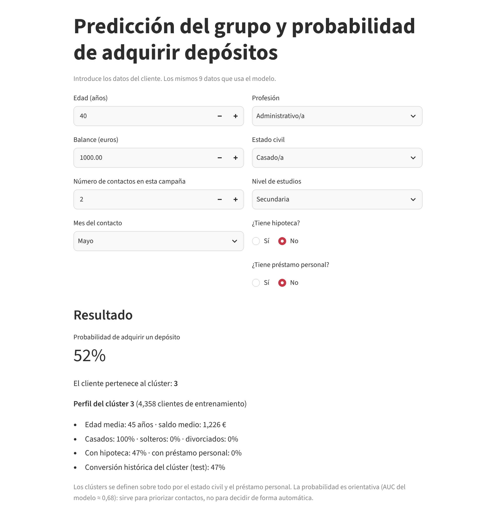
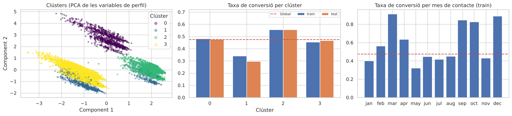
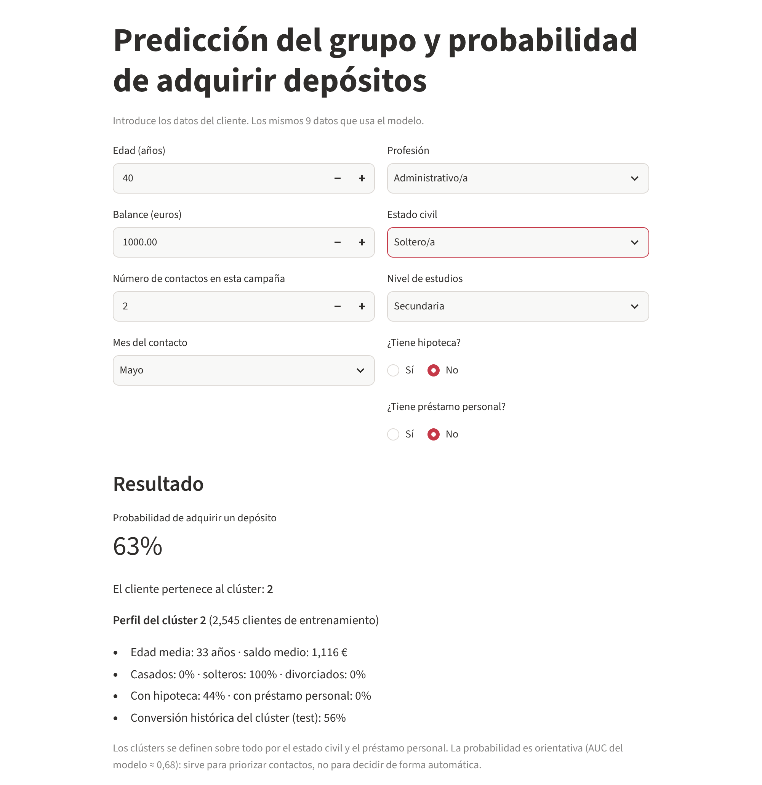
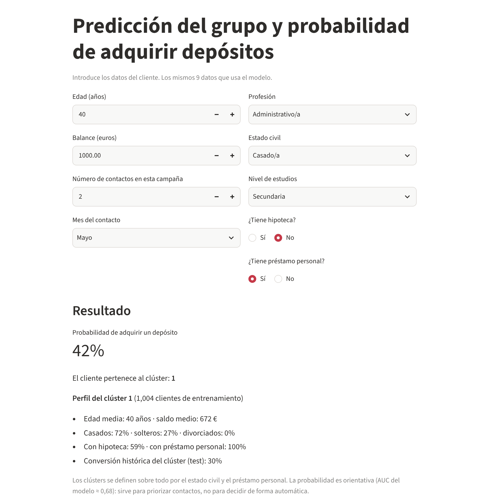

# Bank Deposit Sales: Customer Segmentation & Purchase Prediction

Machine learning project that segments bank customers (K-means) and predicts each customer's probability of subscribing to a term deposit (logistic regression), with an interactive prediction app.

**[Try the Prediction App →](https://projecte-machine-learning-nicola.streamlit.app/)**



---

## Business Problem

A bank sells long-term deposits to a diverse customer base. The goal is to **increase deposit sales** by:

1. **Segmenting customers** by characteristics such as demographics and past behavior.
2. **Estimating the probability of purchase** for each customer.

Segmentation can be done with spreadsheets or statistical software, but a machine learning pipeline can be **retrained on a schedule** and incorporate new transactions without manual work. *(Retraining is a design goal; automated retraining is not implemented yet.)*

**Success metric:** growth in annual deposit sales.

---

## Project Workflow

| Step | Notebook | What it does |
|------|----------|--------------|
| 1 | `01_ML_Project .ipynb` | Project definition: objectives, methodology, metrics, ethics |
| 2 | `02_Documentació_recol·lecció_de_dades.ipynb` | Data sources and collection documentation |
| 3 | [`03_EDA.ipynb`](https://github.com/Nicolakorff/BankMLProject/blob/main/03_EDA.ipynb) | Exploratory data analysis ([HTML report](04_EDA_report.html)) |
| 4 | [`05_Data_preprocessing_and_modeling.ipynb`](05_Data_preprocessing_and_modeling.ipynb) | Preprocessing, K-means, logistic regression, evaluation, saved models |
| 5 | [`app.py`](app.py) | Streamlit app that serves the saved models |

### What the exploratory analysis found (`03_EDA.ipynb`)

- Missing values in `age`, `marital` and `education` were imputed (`unknown` for the categorical ones, the mean for age); outliers were treated with IQR winsorization.
- The target `deposit` is balanced (47.4% yes / 52.6% no), so no resampling was needed.
- Chi-square tests show that every categorical variable is associated with the target, and group means of the numeric variables differ significantly.
- `duration` is the numeric variable most correlated with `deposit`, and `campaign` is negatively correlated with it. `duration` is excluded from the models because it is only known once the call has ended, so it cannot be used to decide whom to call (it would leak the outcome).

---

## Data

- **Source:** CSV export of the bank's telephone marketing campaigns, provided with the project brief (see notebook 02). The file appears to match the public *Bank Marketing* dataset (Moro, Cortez & Rita, 2014; UCI) in schema and size.
- **Size:** 11,162 rows × 17 columns.
- **Target variable:** `deposit` (subscribed to a term deposit: yes/no). Class balance: 47.4% yes / 52.6% no.
- **Features used in the models (9):** age, job (grouped into 5 categories), marital status, education, balance, housing loan, personal loan, contact month, number of contacts in the campaign.
- **Features dropped (7):** `default`, `contact`, `day`, `duration`, `pdays`, `previous`, `poutcome`.
- **Split:** 80/20 stratified (random_state=22): 8,929 training and 2,233 test rows.
- **Segmentation variables (8):** only customer-profile variables (age, balance, education, housing loan, personal loan, marital status), all standardized. Contact month and number of contacts describe the call, not the customer, and `job` is left out because its numeric coding is arbitrary and makes the clusters unstable.
- **Preprocessing** (in [`bank_utils.py`](bank_utils.py), shared by the notebook and the app): ordinal encoding (education, month), job grouping, one-hot encoding (marital status), binary encoding (housing, loan), IQR winsorization of `balance` and `RobustScaler` on age/balance/campaign. Both are **fitted on the training set only**.

---

## Methodology

| Task | Algorithm | Why |
|------|-----------|-----|
| Customer segmentation | **K-means** | Groups customers into segments by shared characteristics |
| Purchase prediction | **Logistic regression** | Suited to binary classification; outputs a probability and minimizes log-loss |

### Evaluation metrics

**Classification (logistic regression)**
- **ROC-AUC:** ability to rank customers by likelihood of buying.
- **Accuracy, precision, recall, F1-score:** balance between false positives and false negatives.
- **Confusion matrix:** type of errors the model makes.
- **Log-loss:** quality of the predicted probabilities, not only the class.
- **5-fold cross-validation** on the training set and a **baseline** (always predict the majority class).

**Clustering (K-means)**
- **Inertia:** within-cluster sum of squared distances (minimized by K-means).
- **Silhouette score:** how well separated the clusters are.
- **Davies-Bouldin index:** average similarity between each cluster and its closest one (lower is better).
- **Calinski-Harabasz index:** ratio of between- to within-cluster dispersion (higher is better).

---

## Results

### Prediction model (logistic regression, test set, n = 2,233)

| Metric | Value |
|--------|-------|
| ROC-AUC | 0.682 (5-fold CV on train: 0.675 ± 0.005) |
| Accuracy | 64.6% (baseline: 52.6%) |
| Precision | 63.1% |
| Recall | 61.1% |
| F1-score | 0.621 |
| Log-loss | 0.643 |

Confusion matrix (rows = actual, columns = predicted):

|  | Predicted no | Predicted yes |
|--|--------------|---------------|
| **Actual no** | 797 | 378 |
| **Actual yes** | 412 | 646 |

The model beats the baseline (AUC 0.5) but only moderately, which is expected with 9 customer-level features and no information about the call itself. It is useful to **prioritize contacts**, not to decide automatically.

**What drives the prediction** (sign of the coefficients; numeric variables are scaled):

| Lowers the probability | Raises the probability |
|------------------------|------------------------|
| Housing loan (odds ratio 0.49), personal loan (0.66), more contacts in the campaign (0.69), being married (0.73) | Balance (1.27), age (1.18), education (1.17), qualified job (1.16), being single (1.16) |

### Segmentation (K-means, k = 4, fitted on the training set)

k was selected by comparing four metrics for k = 2 to 9 (first rows shown):

| k | Inertia | Silhouette | Davies-Bouldin ↓ | Calinski-Harabasz ↑ |
|---|---------|-----------|------------------|---------------------|
| 2 | 54,304 | 0.268 | 1.474 | 2,816 |
| 3 | 42,376 | 0.341 | 1.243 | 3,060 |
| **4** | **36,345** | **0.359** | **1.208** | **2,872** |
| 5 | 31,523 | 0.317 | 1.228 | 2,825 |
| 6 | 28,769 | 0.314 | 1.180 | 2,646 |

k = 4 has the highest silhouette (k = 3 is a close alternative). The structure is weak-to-moderate but **stable**: silhouette 0.359 on train and 0.358 on test, and identical clusters across 5 random seeds (ARI = 1).

| Segment | Customers (train) | Profile | Avg. age | Avg. balance | Conversion (train / test) |
|---------|-------------------|---------|----------|--------------|---------------------------|
| 2 | 2,545 | Single, no personal loan | 33 | €1,116 | **55.6% / 55.6%** |
| 0 | 1,022 | Divorced | 48 | €1,010 | 48.1% / 47.6% |
| 3 | 4,358 | Married, no personal loan | 45 | €1,226 | 45.5% / 46.8% |
| 1 | 1,004 | All have a personal loan, mostly married (72%) | 40 | €672 | **34.1% / 29.7%** |



The differences in conversion between segments are statistically significant (chi-square p ≈ 8·10⁻³²), and the logistic model's average predicted probability per segment is consistent with the observed rates. Segments are defined mainly by **marital status** and **personal loan**, which the prediction model also uses, so the segmentation adds a descriptive reading for marketing rather than extra predictive power.

### Key findings

- Single customers without a personal loan are the most receptive segment (55.6% conversion); customers with a personal loan are the least (30-34%).
- Having a housing or personal loan is the clearest signal of a lower probability of subscribing.
- Conversion depends strongly on the **month of contact** (from about 33% in May to about 90% in March and December), but encoding the month as a number hides it. Encoding it as a category raises the test AUC from 0.682 to **0.711** (experiment in notebook 05, section 10).

---

## App Preview

The app takes the 9 customer data points used by the model and returns the purchase probability, the customer's segment and that segment's profile.

| Single customer, no personal loan | Married customer with a personal loan |
|---|---|
|  |  |

---

## Repository Structure

```
BankMLProject/
├── 01_ML_Project .ipynb
├── 02_Documentació_recol·lecció_de_dades.ipynb
├── 03_EDA.ipynb
├── 04_EDA_report.html
├── 05_Data_preprocessing_and_modeling.ipynb
├── bank_utils.py            # preprocessing shared by notebook and app
├── app.py                   # Streamlit prediction app
├── models/                  # preprocessor, K-means, logistic regression, metadata
├── datasets/
└── requirements.txt
```

---

## How to Run

```bash
git clone https://github.com/Nicolakorff/BankMLProject.git
cd BankMLProject
pip install -r requirements.txt
streamlit run app.py
```

To retrain the models, run `05_Data_preprocessing_and_modeling.ipynb`; it rewrites the files in `models/`.

> The models in `models/` were trained with **scikit-learn 1.9.1**, which is pinned in `requirements.txt`. Pickled models can fail to load with a different version.

---

## Ethical and Social Considerations

The system uses customers' personal data, so it must comply with data protection law (e.g. **GDPR** in Europe).

- **Privacy and data protection:** informed collection, anonymization, data minimization.
- **Bias and fairness:** check for bias in the data, monitor it, keep decisions transparent. Marital status and age are used by the model, so they should be audited before any real use.
- **Transparency and explainability:** the model's decisions can be explained to the business and to customers.
- **Social and economic impact:** personalization may affect inequality in access to services.
- **Accountability in automated decisions:** human oversight and a process to correct errors.
- **Technology risk management.**

---

## Limitations and Next Steps

- Moderate predictive power (AUC 0.68, F1 0.62); a single train/test split plus cross-validation; no other models or hyperparameter tuning tried.
- The EDA imputes missing values and winsorizes the whole dataset before the train/test split, which causes a mild leakage (only `balance` is winsorized again with training limits).
- `retired` and `blue-collar` are grouped as "qualified"; the job grouping should be reviewed.
- Encode the month as a category in the prediction model.
- Segmentation by marital status needs an ethical review before any real use, to avoid discriminatory treatment.
- Scheduled automated retraining and model explainability (SHAP).

---

## Author

**Nicola Korff**
[GitHub](https://github.com/Nicolakorff) | [LinkedIn](https://www.linkedin.com/in/nicola-korff/)
